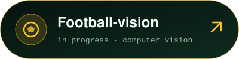
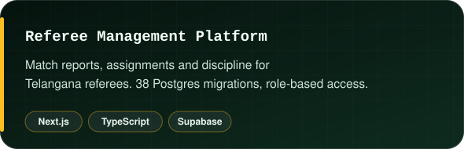
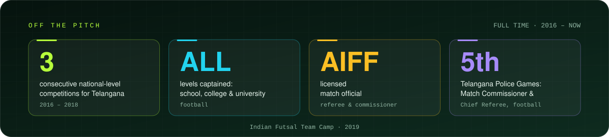

  

  

  
  
  

## The short version

I played the game before I built with data. I've captained football teams at every level of school, college and university, represented Telangana at national level, and I'm now a licensed AIFF match official who has served as Match Commissioner and Chief Referee. Spending years reading the game is why computer vision pulls me in: a pitch is a perfect place to *detect, track and understand* what's happening in real time.

Today I build AI systems end to end: **computer vision**, **RAG and agentic LLM apps**, and **ML models shipped as real APIs and apps**.

  

## Featured projects

<table>
  <tr>
    <td width="50%"></td>
    <td width="50%"></td>
  </tr>
  <tr>
    <td width="50%"></td>
    <td width="50%"></td>
  </tr>
  <tr>
    <td width="50%"></td>
    <td width="50%"></td>
  </tr>
</table>

  

  Built in Hyderabad. Always training, on the pitch and off it.

