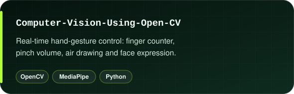

  

  

  
  
  

## About

I'm an AI/ML engineer who builds things that actually run: models that are trained and evaluated properly, and LLM applications that are grounded, tested and shipped behind real APIs.

**What I work on**

- **Training ML models:** end-to-end pipelines from data cleaning and EDA to feature engineering, training and evaluation. Classical ML (regression, classification, tree ensembles, clustering) and deep learning (CNNs, RNN/LSTM, Transformers) in scikit-learn, TensorFlow/Keras and PyTorch.
- **Building and integrating LLM applications:** RAG pipelines with embeddings and vector databases, chunking and retrieval tuning, grounded prompts with "I don't know" fallbacks, and multi-provider LLM APIs.
- **Agentic systems:** tool-calling agents and multi-agent workflows with LangGraph, LangChain and CrewAI, plus MCP for connecting tools.
- **Fine-tuning and local models:** adapting open-source LLMs and running them locally with Ollama.
- **Evaluation, observability and guardrails:** measuring whether LLM outputs are right, tracing what happened, and constraining what they can say.
- **Computer vision:** real-time systems with OpenCV and MediaPipe, and a long-term project on football match analysis.
- **Shipping:** FastAPI services, Streamlit apps, Docker, Git, and full-stack products on Next.js and Supabase.

**Why football matters to how I build**

Football shaped how I work. I've captained teams at every level of school, college and university, represented Telangana at national level, and I'm a licensed AIFF match official who has served as Match Commissioner and Chief Referee at the 5th Telangana Police Games. It taught me to read a situation fast, make decisions under pressure, lead a team and stay fair when it counts. It's also why I'm drawn to computer vision: a pitch is the perfect place to *detect, track and understand* what's happening in real time.

## Tech stack

  

## Selected work

<table>
  <tr>
    <td width="50%"></td>
    <td width="50%"></td>
  </tr>
  <tr>
    <td width="50%"></td>
    <td width="50%"></td>
  </tr>
  <tr>
    <td width="50%"></td>
    <td width="50%"></td>
  </tr>
</table>

## Off the pitch

  

