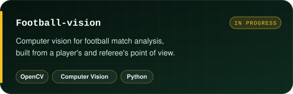
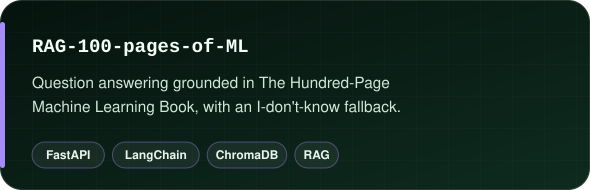
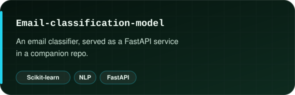

  

  

  
  
  

## About

I played the game before I built with data. I've captained football teams at every level of school, college and university, represented Telangana at national level, and I'm now a licensed AIFF match official who has served as Match Commissioner and Chief Referee. Years of reading the game is why computer vision pulls me in: a pitch is the perfect place to *detect, track and understand* what's happening in real time.

Today I build AI systems end to end: **computer vision**, **RAG and agentic LLM apps**, and **ML models shipped as real APIs and apps**.

## Tech stack

  

## Selected work

<table>
  <tr>
    <td width="50%"></td>
    <td width="50%"></td>
  </tr>
  <tr>
    <td width="50%"></td>
    <td width="50%"></td>
  </tr>
  <tr>
    <td width="50%"></td>
    <td width="50%"></td>
  </tr>
</table>

## Off the pitch

  

